<div align="center">

# Islami App

Islami App is a **Flutter** application that gathers essential Islamic resources in one place:

</div>

## AppScreen

<table>
  <tr>
    <td align="center">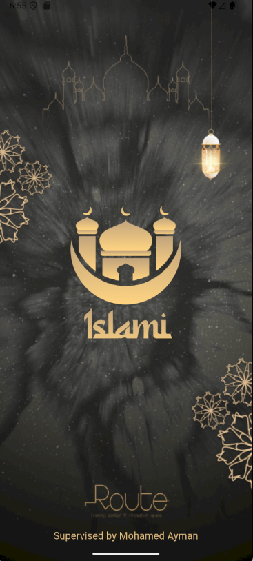<br><sub>Splash Screen</sub></td>
    <td align="center">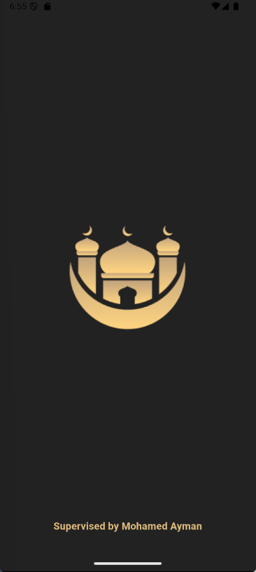<br><sub>Splash Screen2</sub></td>
    <td align="center">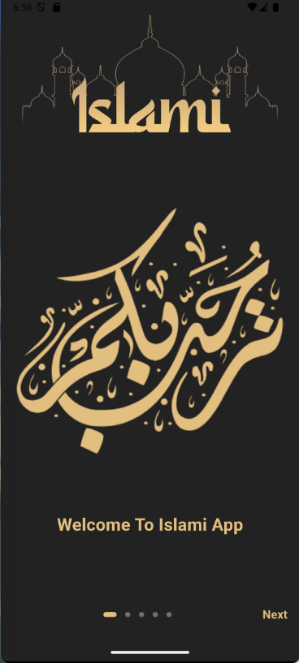<br><sub>OoBoarding1 Screen</sub></td>
    <td align="center">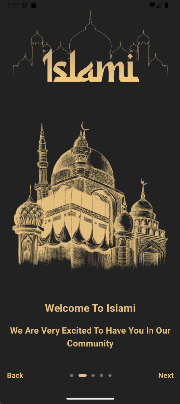<br><sub>OnBoarding2 Screen</sub></td>
  </tr>
    <tr>
    <td align="center">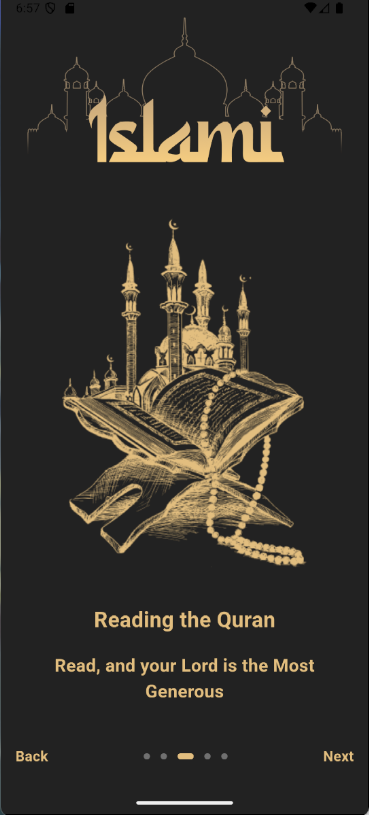<br><sub>OnBoarding3 Screen</sub></td>
    <td align="center">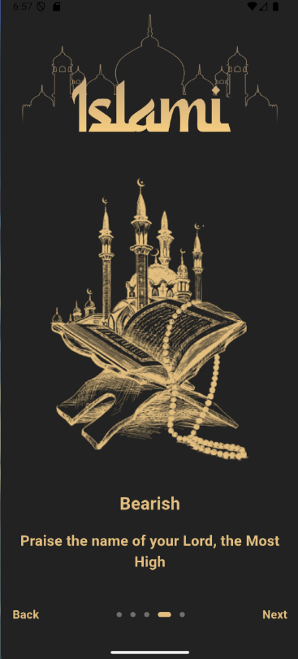<br><sub>OnBoarding4 Screen</sub></td>
    <td align="center">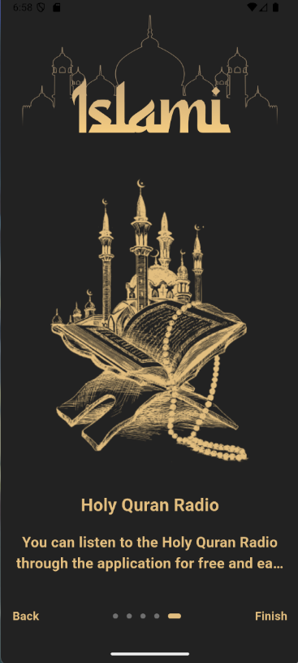<br><sub>OoBoarding5 Screen</sub></td>
    <td align="center">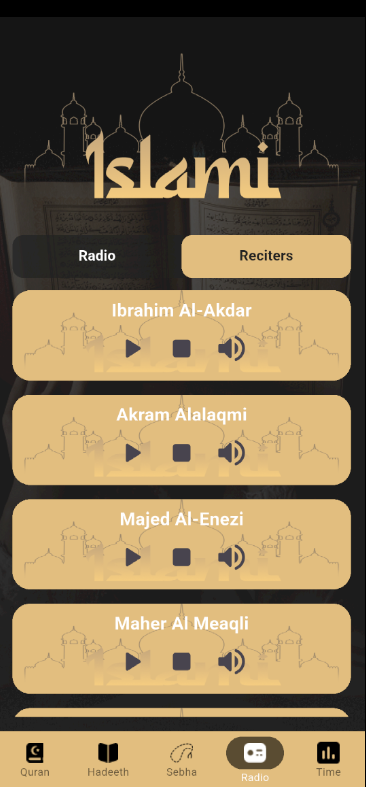<br><sub>Radio Reciters Screen</sub></td>
  </tr>
    <tr>
    <td align="center">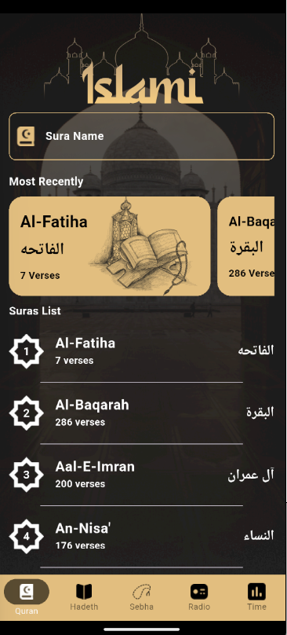<br><sub>Quran Tab Screen</sub></td>
    <td align="center">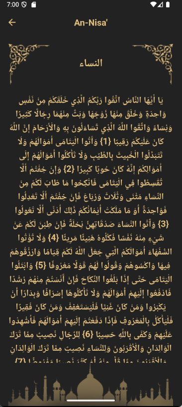<br><sub>Sura Detailed Screen</sub></td>
    <td align="center">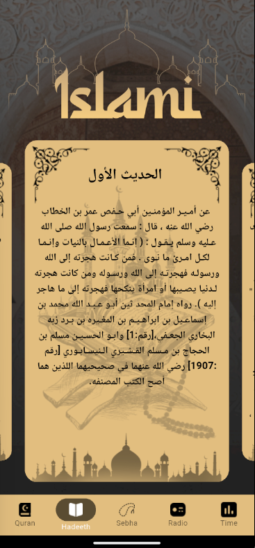<br><sub>Hadeeth Tab Screen</sub></td>
    <td align="center">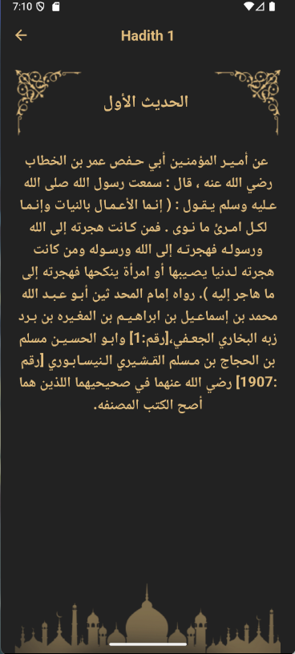<br><sub>Hadeeth Detailed Screen</sub></td>
  </tr>
      <tr>
    <td align="center">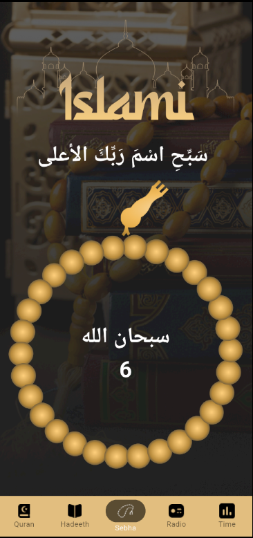<br><sub>Sebha Screen</sub></td>
    <td align="center">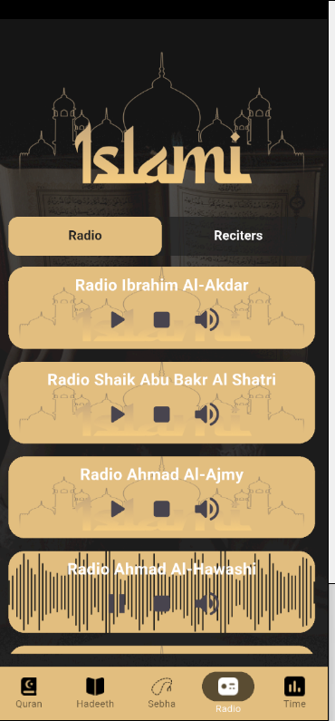<br><sub>Radio Tab Screen</sub></td>
    <td align="center">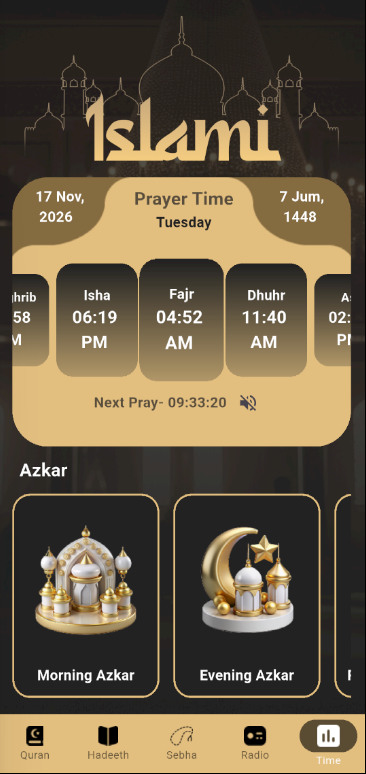<br><sub>Time Tab Screen</sub></td>
    <td align="center">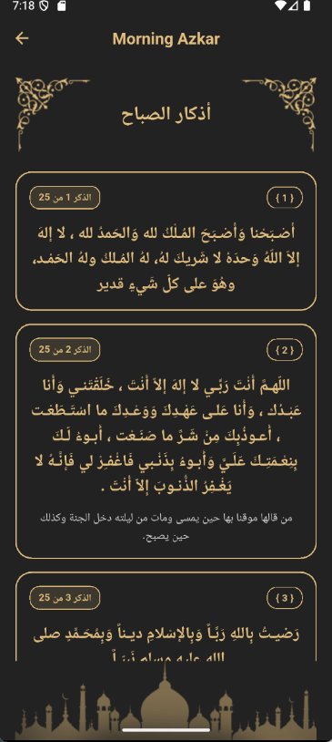<br><sub>Azkar Detailed Screen</sub></td>
  </tr>
</table>

## Features

- **Azkar**
  - Category cards on the Home screen.
  - Detailed view listing all supplications for a chosen category.
  - Count‑based ordering with automatic persistence.
- **Quran**
  - List of all 114 Suras, searchable by Arabic or English name.
  - Search bar (Arabic/English) with live filtering.
  - “Most Recently Read” horizontal list for quick navigation.
  - Detailed sura screen presenting verses in a scrollable list.
- **Radio**
  - Live streaming of Islamic radio stations.
  - Mute/unmute handling that preserves volume when switching stations.
- **Hadeeth**
  - Simple list navigation for hadith collections.
- **Sebha**
  - A dashboard that displays the list of tasabeeh with counter.
- **Time**
  - A dashboard that displays the current time, prayer times.

## Tech Stack

- **Flutter / Dart** – UI framework and language.
- **Provider** – Simple yet powerful state‑management and dependency injection.
- **Material UI** – Core Material widgets (no custom theming layer).
- **http** for HTTP requests to News API.
- **SharedPreferences** for local caching.
- **audioPlayers** Audio playback for radio streaming.
- **cached_network_image** for article imagery.
- **animate_do** for animations.
- **carousel_slider** Image carousel widgets.

## Architecture

The project follows a clean, feature‑driven layout and includes the onboarding/splash components:

```
lib/
├── core/                 # Constants, images, routes, providers, utils
│   ├── model/            # Data models (AzkarCategoryModel, SuraDM, etc.)
│   ├── api/              # Network folder (http)
│   ├── provider/         # State management
│   └── utils/            # Styles, colors, images, constants, routes, storage, date formatter
├── features/
│   ├── splash/           # SplashScreen implementation
│   ├── onboarding/       # (Optional) onboarding flow screens
│   ├── home/             # HomeScreen, navigation layout
│   ├── time/             # Azkar and Time widgets & screens
│   ├── quran/            # Quran widgets, search, detail screens
│   ├── radio/            # Radio streaming UI & logic
│   ├── sebha/            # Sebha screen\
│   └── hadeeth/          # Widget && Hadeeth screen
└── main.dart             # Application entry point
```

---

# 👨‍💻 Developer

<div align="center">

## Mohamed Ayman

**Flutter Developer**

Passionate about building modern, responsive, and scalable Flutter applications.

<p align="center">
<a href="https://github.com/mohamedayman891">

</a>

<a href="https://www.linkedin.com/in/mohamed-ayman09">

</a>
</p>

</div>

---
